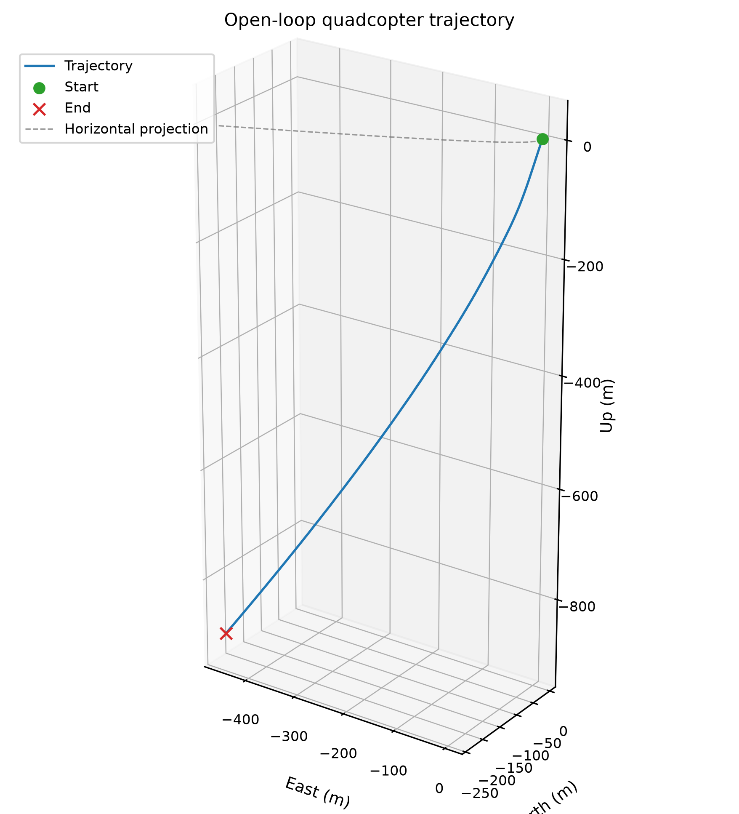
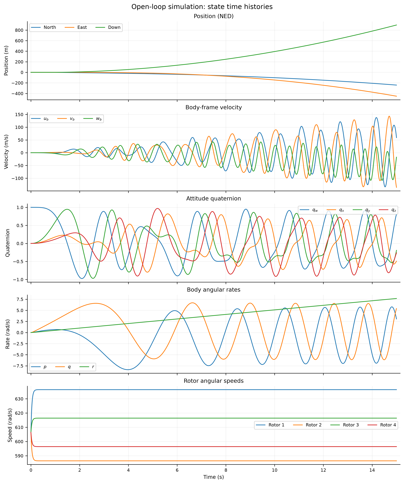
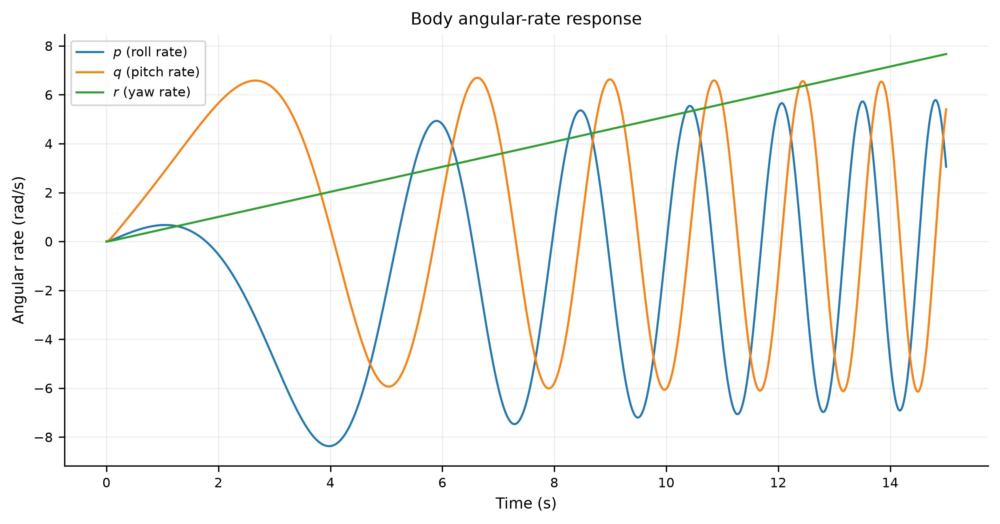
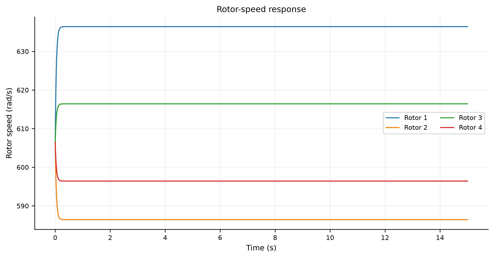

# Open-Loop Asymmetric Quadcopter Simulation

[Documentation index](README.md)

## Contents

1. [Purpose](#1-purpose)
2. [Model Configuration](#2-model-configuration)
3. [Coordinate Conventions](#3-coordinate-conventions)
4. [State Vector](#4-state-vector)
5. [Initial Conditions](#5-initial-conditions)
6. [Open-Loop Rotor Commands](#6-open-loop-rotor-commands)
7. [Numerical Integration](#7-numerical-integration)
8. [Output Data](#8-output-data)
9. [Visualization](#9-visualization)
10. [Recorded Results](#10-recorded-results)
11. [Reproducing the Simulation](#11-reproducing-the-simulation)
12. [Limitations](#12-limitations)

---

## 1. Purpose

This document describes the open-loop asymmetric rotor simulation implemented in `controller/cpp/examples/open_loop_asymmetric.cpp`.

The simulation uses the C++ nonlinear quadcopter dynamics model and applies fixed, asymmetric rotor-speed commands without a flight controller. It records the coupled vehicle states over time for numerical inspection and visualization.

> [!NOTE]
> The simulation is intended to examine the model's response to asymmetric rotor commands. It is not a flight test, closed-loop control demonstration, or independent validation against experimental data.

## 2. Model Configuration

The example uses the following model parameters.

| Parameter | Value | Unit |
|---|---:|---|
| Vehicle mass | 1.2 | kg |
| Gravitational acceleration | 9.80665 | m/s² |
| Roll-axis moment of inertia, $I_{xx}$ | 0.015 | kg·m² |
| Pitch-axis moment of inertia, $I_{yy}$ | 0.015 | kg·m² |
| Yaw-axis moment of inertia, $I_{zz}$ | 0.025 | kg·m² |
| Rotor thrust coefficient, $k_T$ | $8.0\times10^{-6}$ | N/(rad/s)² |
| Reaction-torque coefficient, $k_Q$ | $1.5\times10^{-7}$ | N·m/(rad/s)² |
| Rotor arm offset, $d$ | 0.141421356 | m |
| Maximum rotor speed | 1200 | rad/s |
| Motor time constant, $\tau_m$ | 0.04 | s |

The inertia tensor is diagonal in the current model.

## 3. Coordinate Conventions

The model uses these coordinate conventions:

- Inertial frame: North-East-Down (NED).
- Body frame: Forward-Right-Down (FRD).
- Position: inertial-frame coordinates.
- Translational velocity: body-frame components.
- Angular velocity: body-frame components.
- Attitude: scalar-first quaternion.

The quaternion is stored as:

$$
\mathbf q=
\begin{bmatrix}
q_w&q_x&q_y&q_z
\end{bmatrix}^{T}
$$

The down component of NED position is positive downward. Therefore, the plotting script uses $-p_d$ for its upward display coordinate.

## 4. State Vector

The simulation records 17 states.

| State group | Variables | Count |
|---|---|---:|
| Inertial position | $p_n,p_e,p_d$ | 3 |
| Body-frame velocity | $u_b,v_b,w_b$ | 3 |
| Attitude quaternion | $q_w,q_x,q_y,q_z$ | 4 |
| Body angular rates | $p,q,r$ | 3 |
| Rotor angular speeds | $\Omega_1,\Omega_2,\Omega_3,\Omega_4$ | 4 |
| **Total** | | **17** |

The complete state vector is:

$$
\mathbf x=
\begin{bmatrix}
p_n&p_e&p_d&
u_b&v_b&w_b&
q_w&q_x&q_y&q_z&
p&q&r&
\Omega_1&\Omega_2&\Omega_3&\Omega_4
\end{bmatrix}^{T}
$$

## 5. Initial Conditions

The simulation starts at the inertial origin with zero translational velocity, identity attitude, and zero body angular rates.

Initial position:

$$
\mathbf p_{\mathrm{NED}}(0)=
\begin{bmatrix}
0&0&0
\end{bmatrix}^{T}\ \text{m}
$$

Initial body velocity:

$$
\mathbf v_b(0)=
\begin{bmatrix}
0&0&0
\end{bmatrix}^{T}\ \text{m/s}
$$

Initial attitude:

$$
\mathbf q(0)=
\begin{bmatrix}
1&0&0&0
\end{bmatrix}^{T}
$$

Initial body angular rates:

$$
\boldsymbol\omega_b(0)=
\begin{bmatrix}
0&0&0
\end{bmatrix}^{T}\ \text{rad/s}
$$

All four initial rotor speeds are set to the calculated hover speed:

$$
\Omega_{\mathrm{hover}}=
\sqrt{\frac{mg}{4k_T}}
$$

Using the configured parameters:

$$
\Omega_{\mathrm{hover}}
=
\sqrt{
\frac{1.2(9.80665)}
{4(8.0\times10^{-6})}
}
\approx606.423\ \text{rad/s}
$$

> [!NOTE]
> This value balances weight with total rotor thrust under the model's thrust equation, assuming four equal rotor speeds and the modeled thrust direction. It does not guarantee that the vehicle remains in hover after asymmetric commands are applied.

## 6. Open-Loop Rotor Commands

The simulation applies constant rotor-speed commands offset from the calculated hover speed.

| Rotor | Command | Approximate command |
|---|---|---:|
| Rotor 1 | $\Omega_{\mathrm{hover}}+30$ | 636.423 rad/s |
| Rotor 2 | $\Omega_{\mathrm{hover}}-20$ | 586.423 rad/s |
| Rotor 3 | $\Omega_{\mathrm{hover}}+10$ | 616.423 rad/s |
| Rotor 4 | $\Omega_{\mathrm{hover}}-10$ | 596.423 rad/s |

In vector form:

$$
\boldsymbol\Omega_{\mathrm{cmd}}=
\begin{bmatrix}
\Omega_{\mathrm{hover}}+30\\
\Omega_{\mathrm{hover}}-20\\
\Omega_{\mathrm{hover}}+10\\
\Omega_{\mathrm{hover}}-10
\end{bmatrix}
$$

The commands remain fixed throughout the simulation. No feedback controller adjusts them in response to the vehicle's state.

The actual rotor speeds respond through the motor dynamics rather than jumping instantaneously to the commanded values.

## 7. Numerical Integration

The simulation uses a fourth-order Runge–Kutta (RK4) integrator.

| Setting | Value |
|---|---:|
| Integration method | Classical RK4 |
| Time step, $\Delta t$ | 0.001 s |
| Simulation duration | 15 s |
| Integration steps | 15,000 |
| Recorded samples | 15,001, including the initial state |

The time step is:

$$
\Delta t=0.001\ \text{s}
$$

The simulation records the initial state at $t=0$ and then records the state after every integration step. The expected final time is therefore 15 seconds.

The integrator normalizes the attitude quaternion after each completed integration step. This helps control numerical drift in quaternion magnitude; it does not independently validate the attitude equations.

## 8. Output Data

The C++ example writes the simulation results to:

`controller/cpp/examples/open_loop_asymmetric_state.csv`

The CSV contains a time column and all 17 states, giving 18 columns in total.

| Column | Description | Unit |
|---|---|---|
| `time_s` | Simulation time | s |
| `pn`, `pe`, `pd` | NED position | m |
| `ub`, `vb`, `wb` | Body-frame translational velocity | m/s |
| `qw`, `qx`, `qy`, `qz` | Scalar-first attitude quaternion | Dimensionless |
| `p`, `q`, `r` | Body angular rates | rad/s |
| `rotor1_rad_s` to `rotor4_rad_s` | Actual rotor angular speeds | rad/s |

The C++ writer uses 17 significant decimal digits for the recorded floating-point values.

## 9. Visualization

The plotting script is:

`controller/cpp/examples/visualize_open_loop.py`

It reads the CSV, checks that required columns exist, verifies that the dataset is non-empty and finite, and requires time values to increase strictly.

The script saves four PNG figures in:

`controller/cpp/examples/results/`

### 9.1 Three-dimensional trajectory

File: `open_loop_trajectory_3d.png`

The trajectory is plotted using East, North, and Up display coordinates. The plot marks the initial and final positions and shows the horizontal projection at the initial altitude.



### 9.2 Full-state time histories

File: `open_loop_full_state.png`

This figure contains five stacked plots:

1. NED position.
2. Body-frame translational velocity.
3. Quaternion components.
4. Body angular rates.
5. Four rotor angular speeds.



### 9.3 Body angular-rate response

File: `open_loop_body_rates.png`

This plot shows roll rate $p$, pitch rate $q$, and yaw rate $r$ as functions of time.



### 9.4 Rotor-speed response

File: `open_loop_rotor_speeds.png`

This plot shows the actual angular-speed histories of all four rotors.



> [!NOTE]
> All figures are saved as PNG files at 300 DPI. Regenerate the figures whenever the model, initial conditions, rotor commands, or integration settings change.

## 10. Recorded Results

The final state must be taken from the CSV generated by the current source code and configuration.

Record the final state using the following table after running the simulation:

| State | Final value | Unit |
|---|---:|---|
| North position, $p_n$ | Read from CSV | m |
| East position, $p_e$ | Read from CSV | m |
| Down position, $p_d$ | Read from CSV | m |
| Forward velocity, $u_b$ | Read from CSV | m/s |
| Right velocity, $v_b$ | Read from CSV | m/s |
| Down velocity, $w_b$ | Read from CSV | m/s |
| Quaternion scalar, $q_w$ | Read from CSV | Dimensionless |
| Quaternion x component, $q_x$ | Read from CSV | Dimensionless |
| Quaternion y component, $q_y$ | Read from CSV | Dimensionless |
| Quaternion z component, $q_z$ | Read from CSV | Dimensionless |
| Roll rate, $p$ | Read from CSV | rad/s |
| Pitch rate, $q$ | Read from CSV | rad/s |
| Yaw rate, $r$ | Read from CSV | rad/s |
| Rotor 1 speed | Read from CSV | rad/s |
| Rotor 2 speed | Read from CSV | rad/s |
| Rotor 3 speed | Read from CSV | rad/s |
| Rotor 4 speed | Read from CSV | rad/s |

> [!IMPORTANT]
> These entries should be replaced with values from the same run used to generate the plots. Do not mix values from different simulation runs.

> [!WARNING]
> The output describes the behavior of the current numerical model under sustained asymmetric rotor commands. Large position, velocity, or angular-rate changes are possible because the simulation has no active flight controller.

## 11. Reproducing the Simulation

Run the commands from the repository root.

Configure the C++ project:

```bash
cmake -S controller/cpp -B controller/cpp/build
```

Build the open-loop executable:

```bash
cmake --build controller/cpp/build --target open_loop_asymmetric
```

Run the simulation:

```bash
controller/cpp/build/open_loop_asymmetric.exe
```

> [!NOTE]
> On Windows, the executable is expected at the path shown above when using the default CMake generator and build layout. If your generator places executables in a configuration subdirectory, use the corresponding executable path.

> [!NOTE]
> The program writes the CSV to a repository-relative path, so run it from the repository root.

Regenerate the figures:

```bash
python controller/cpp/examples/visualize_open_loop.py
```

The plotting script requires Python, NumPy, pandas, and Matplotlib.

## 12. Limitations

- The simulation is open-loop; no flight controller is active.
- The rotor commands are fixed throughout the run.
- The initial hover speed is calculated from the model's mass, gravity, and thrust coefficient.
- The simulation does not include validation against flight-test measurements.
- A successful numerical run does not independently prove that the physical model or its parameters are accurate.
- Quaternion normalization controls numerical drift but does not guarantee correct attitude dynamics.
- Results depend on the current model equations, parameters, initial conditions, rotor commands, and integration settings.
- Further work should include time-step convergence studies, comparison against a trusted reference implementation, and validation against experimental data where available.
