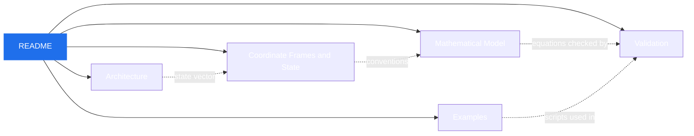

# 🚁 Quadcopter Flight Dynamics Simulator

### Technical Documentation

*Six-degree-of-freedom rigid-body model · quaternion attitude · first-order rotor dynamics · RK4 integration*

---

This folder contains technical documentation for the **Quadcopter Flight Dynamics Simulator**.

## 📑 Table of Contents

1. [Documents](#-documents)
2. [Documentation Map](#-documentation-map)
3. [Scope](#-scope)

---

## 📚 Documents

| # | Document | Description |
|:-:|---|---|
| 1 | [🏗️ Architecture](architecture.md) | Software modules and data flow. |
| 2 | [📐 Mathematical Model](mathematical_model.md) | Equations implemented by the current model. |
| 3 | [🧭 Coordinate Frames and State](coordinate_frames.md) | Frame conventions, quaternion ordering, and state vector. |
| 4 | [✅ Validation](validation.md) | Current checks, observed results, and limitations. |
| 5 | [▶️ Examples](examples.md) | How to run the example scripts. |

## 🗺️ Documentation Map

## 🎯 Scope

> [!IMPORTANT]
> These documents describe the **current Python implementation** and the **tests performed so far**. They do **not** claim validation against measured flight data. Vehicle and propulsion parameters are **provisional illustrative values**, not measured hardware data.
