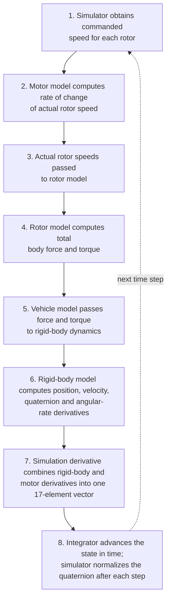

# 🏗️ Software Architecture

[⬅ Back to documentation index](README.md)

## 📑 Contents

1. [Overview](#1-overview)
2. [Main directories](#2-main-directories)
3. [State flow](#3-state-flow)
4. [State vector](#4-state-vector)
5. [Design boundaries](#5-design-boundaries)

---

## 1. Overview

The simulator is organized into **configuration**, **physical models**, **numerical integration**, **simulation orchestration**, **examples**, and **automated tests**.

## 2. Main directories

| Path | Responsibility |
|---|---|
| `config/vehicle.py` | Vehicle mass, gravity, inertia, rotor geometry, motor time constant, and provisional propulsion coefficients. |
| `src/quadcopter/frames.py` | Quaternion normalization, quaternion multiplication, and rotation-matrix operations. |
| `src/quadcopter/state.py` | Packs and unpacks the 17-element state vector. |
| `src/quadcopter/motors.py` | First-order motor-speed dynamics and command validation. |
| `src/quadcopter/rotors.py` | Converts rotor speeds into thrust, body force, and body torque. |
| `src/quadcopter/dynamics.py` | Six-degree-of-freedom rigid-body equations. |
| `src/quadcopter/vehicle.py` | Combines propulsion outputs with rigid-body dynamics. |
| `src/quadcopter/simulation.py` | Builds the derivative of the combined vehicle-and-motor state. |
| `src/quadcopter/integrators.py` | Numerical integration methods, including RK4. |
| `src/quadcopter/simulator.py` | Runs a time history, evaluates motor commands, and normalizes the quaternion during integration. |
| `examples/` | Executable demonstrations and validation scripts. |
| `tests/` | Automated tests for model components and simulation behavior. |

## 3. State flow

Step-by-step:

1. The simulator obtains the commanded speed for each rotor.
2. The motor model calculates the rate of change of actual rotor speed.
3. Actual rotor speeds are passed to the rotor model.
4. The rotor model calculates total body force and torque.
5. The vehicle model passes force and torque to the rigid-body dynamics.
6. The rigid-body model calculates position, velocity, quaternion, and angular-rate derivatives.
7. The simulation derivative combines the rigid-body and motor derivatives into one 17-element derivative vector.
8. The integrator advances the state in time. The simulator normalizes the quaternion after each integration step.

## 4. State vector

The state vector has **17 elements**:

| Indices (Python slicing) | Variable | Size | Units |
|---|---|---:|---|
| `0:3` | Position in NED | 3 | m |
| `3:6` | Velocity in body axes | 3 | m/s |
| `6:10` | Scalar-first attitude quaternion | 4 | dimensionless |
| `10:13` | Body angular velocity `[p, q, r]` | 3 | rad/s |
| `13:17` | Actual rotor speeds | 4 | rad/s |

$$
\underbrace{3}_{\text{position}} + \underbrace{3}_{\text{velocity}} + \underbrace{4}_{\text{quaternion}} + \underbrace{3}_{\text{body rates}} + \underbrace{4}_{\text{rotor speeds}} = 17
$$

## 5. Design boundaries

> [!NOTE]
> The current simulator is an **open-loop dynamics model**. The validation examples issue motor-speed commands directly.

A flight controller, state estimator, aerodynamic drag model, sensor model, and hardware interface are not implied by the current implementation and should be documented separately if added later.
